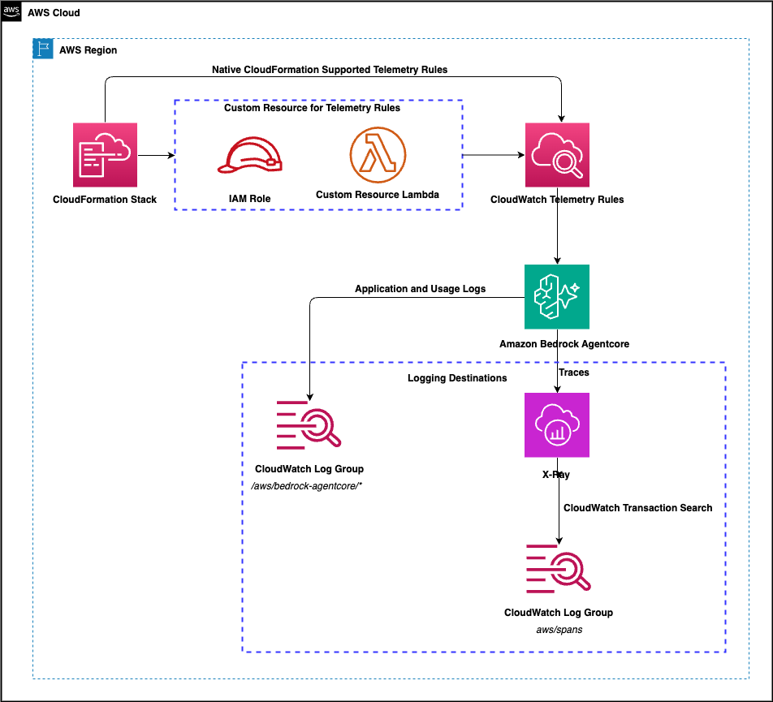

# Enable Amazon Bedrock AgentCore Observability with CloudFormation

Deploy a single CloudFormation stack to turn on CloudWatch logs and X-Ray traces
for every Amazon Bedrock AgentCore resource type: Runtime, Gateway, Memory,
Browser, CodeInterpreter, and WorkloadIdentity.

Uses `AWS::ObservabilityAdmin::TelemetryRule` where the CloudFormation schema
supports it, and the `observabilityadmin` API through a Lambda custom resource
where it does not.


## Prerequisites

- An AWS account with Bedrock AgentCore available in your target region.
- AWS CLI v2 (2.36 or newer) configured with credentials for that account and region. Version 2.36+ includes the `observabilityadmin` telemetry rule operations this stack relies on. On earlier versions, those commands return an "invalid choice" error.
- Permissions to deploy the stack, including creating an IAM role
  (`CAPABILITY_IAM`), a Lambda function, ObservabilityAdmin telemetry rules, and
  an X-Ray resource policy (`xray:PutResourcePolicy`).

### One-time observability setup (per account and region)

Enable the following in each region where you deploy this stack. These are
account and region level settings and are not created by this template.

- **Telemetry Evaluation** (required for the telemetry rule APIs). Enable once
  per account: `aws observabilityadmin start-telemetry-evaluation --region <your-region>`.
  Without it, rule operations fail with a `ValidationException`.

- **CloudWatch Transaction Search** (required for traces). AgentCore trace
  delivery to X-Ray depends on Transaction Search being enabled; without it,
  trace deliveries fail. This is a one-time setup per account and region, via the
  CloudWatch console or the API.
  - [Enable Transaction Search](https://docs.aws.amazon.com/AmazonCloudWatch/latest/monitoring/Enable-TransactionSearch.html)

- **CloudWatch telemetry resource discovery** Enabling telemetry
  configuration lets CloudWatch discover your AWS resources and their telemetry
  configuration metadata (it creates AWS Config service-linked configuration
  recorders). This powers the CloudWatch telemetry overview and helps you see
  which resources have telemetry enabled.
  - [What is telemetry discovery and enablement?](https://docs.aws.amazon.com/AmazonCloudWatch/latest/monitoring/telemetry-config-what-is.html)
  - [Setting up telemetry configuration (Enable Resource Discovery)](https://docs.aws.amazon.com/AmazonCloudWatch/latest/monitoring/telemetry-config-turn-on.html)

## What it deploys

The template creates telemetry enablement rules that apply to all current and
future AgentCore resources of each enabled type in the region. Logs are delivered
to CloudWatch Logs under the pattern
`/aws/bedrock-agentcore/<resourceId>/<logType>`. Traces are delivered to X-Ray
and ingested into the CloudWatch Logs group `aws/spans`.

Two delivery paths are used, depending on CloudFormation schema support:

| Resource type | Path | Telemetry |
|---|---|---|
| Runtime | `AWS::ObservabilityAdmin::TelemetryRule` | Application logs, usage logs, traces |
| Browser | `AWS::ObservabilityAdmin::TelemetryRule` | Usage logs, traces |
| CodeInterpreter | `AWS::ObservabilityAdmin::TelemetryRule` | Application logs, usage logs, traces |
| Gateway | `Custom::TelemetryRule` | Application logs, traces |
| Memory | `Custom::TelemetryRule` | Application logs, traces |
| WorkloadIdentity | `Custom::TelemetryRule` | Application logs, traces |

Gateway, Memory, and WorkloadIdentity are not yet in the CloudFormation schema,
so they are created through an inline Python Lambda that calls the
`observabilityadmin` API and signals CloudFormation using the official
`cfnresponse` module. Create must succeed for every enabled rule; any error
(including a conflict with an existing rule) is reported as a failure so the
stack surfaces it. On delete, a rule that is already gone is treated as success.

### Payload logging and sensitive content

Read this before enabling CodeInterpreter telemetry. CodeInterpreter
`APPLICATION_LOGS` capture the full `request_payload` and `response_payload` of
each `InvokeCodeInterpreter` call, which means the code sent to the interpreter
and the output it returns are written to your log destination. Anything that
appears in that code or output is logged, so treat these logs as potentially
sensitive. Do not place credentials, secrets, tokens, keys, or other sensitive
data in code that CodeInterpreter runs, because it will be captured in the logs.

The telemetry rules created by this stack apply to all current and future
CodeInterpreter resources in the account and region, so the payload capture
takes effect for resources you have not created yet. This template only turns
telemetry on. It does not redact or mask payloads and it does not configure the
controls that protect the captured logs. You are responsible for evaluating and
configuring the following for your log destination.

- Who can read the logs, including log-group read access, subscription filters,
  and export to Amazon S3 or Firehose.
- How long the logs are retained.
- How the logs are encrypted at rest, for example a customer-managed KMS key on
  the destination log group.

If the payload capture is not acceptable for a given resource type, set its
`Enable*Telemetry` parameter to `false` before deploying, or deploy only the
resource types you intend to log.

### Resources created

- Native and custom telemetry rule resources for each enabled resource type
  (scoped to the stack region).
- `AgentCoreXRayResourcePolicy` - an `AWS::XRay::ResourcePolicy` that authorizes
  the log delivery service to write AgentCore traces to X-Ray in this region.
  Created only when at least one resource type is enabled. Required for Browser and CodeInterpreter traces since their ARNs are AWS-owned and the service does not auto-create a policy for them. Do not remove it.
- `TelemetryRuleFunction` - inline Python 3.13 Lambda (custom resource handler),
- `TelemetryRuleFunctionRole` - IAM execution role for the Lambda.

## Architecture



Runtime, Browser, and CodeInterpreter are created directly by CloudFormation as native
`AWS::ObservabilityAdmin::TelemetryRule` resources. Gateway, Memory, and
WorkloadIdentity are created through the inline Lambda custom resource. The
stack also creates the X-Ray resource policy that authorizes trace delivery in
the region.

## Parameters

Each `Enable*Telemetry` parameter controls whether the logging and tracing
telemetry rules for one resource type are created. All default to `"true"`, so a
plain deploy enables telemetry for every resource type in the stack's region.

| Parameter | Default | Allowed values | Effect |
|---|---|---|---|
| `EnableRuntimeTelemetry` | `true` | `true`, `false` | Create logging and tracing rules for Runtime resources |
| `EnableBrowserTelemetry` | `true` | `true`, `false` | Create logging and tracing rules for Browser resources |
| `EnableCodeInterpreterTelemetry` | `true` | `true`, `false` | Create logging and tracing rules for CodeInterpreter resources |
| `EnableGatewayTelemetry` | `true` | `true`, `false` | Create logging and tracing rules for Gateway resources |
| `EnableMemoryTelemetry` | `true` | `true`, `false` | Create logging and tracing rules for Memory resources |
| `EnableWorkloadIdentityTelemetry` | `true` | `true`, `false` | Create logging and tracing rules for WorkloadIdentity resources |

There is no region parameter. The stack acts on the region it is deployed to
(`AWS::Region`).

## Deploy

```bash
aws cloudformation deploy \
  --template-file bedrock-agentcore-telemetry-template.yaml \
  --stack-name bedrock-agentcore-telemetry-enablement \
  --capabilities CAPABILITY_IAM \
  --region <your-region>
```

To disable a resource type, pass its parameter as `false`:

```bash
aws cloudformation deploy \
  --template-file bedrock-agentcore-telemetry-template.yaml \
  --stack-name bedrock-agentcore-telemetry-enablement \
  --capabilities CAPABILITY_IAM \
  --region <your-region> \
  --parameter-overrides EnableBrowserTelemetry=false EnableCodeInterpreterTelemetry=false
```

`CAPABILITY_IAM` is required because the template creates an IAM role for the
Lambda.

### Validate before deploying

```bash
cfn-lint bedrock-agentcore-telemetry-template.yaml
aws cloudformation validate-template --template-body file://bedrock-agentcore-telemetry-template.yaml
```

### Confirm the rules were created

```bash
aws observabilityadmin list-telemetry-rules --region <your-region>
```

## Security

This solution is provided as a proof-of-value and is not intended as a
production-ready implementation. You are responsible for evaluating how the AWS
Shared Responsibility Model applies to your specific use case and for
implementing the necessary security controls to meet your organization's
requirements. AWS provides a broad set of security tools and configurations to
support your security objectives, and it is your responsibility as the developer
to ensure all aspects of your application are appropriately secured for
production use.

## License

See the LICENSE file for licensing information.
